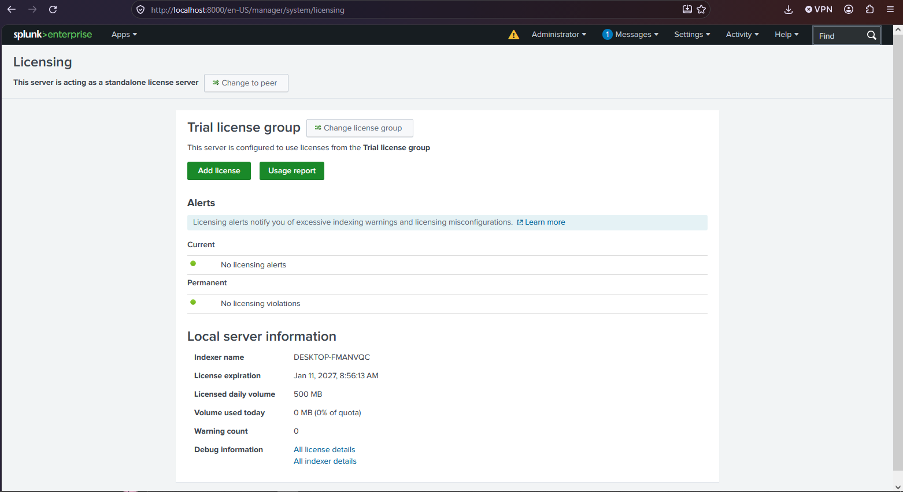
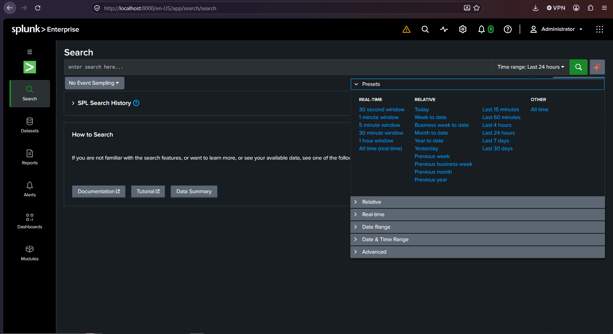
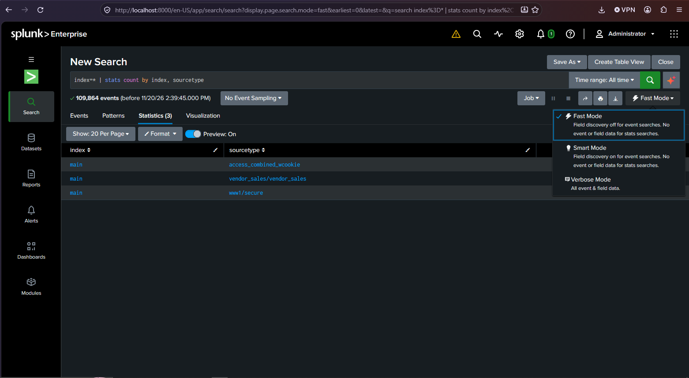
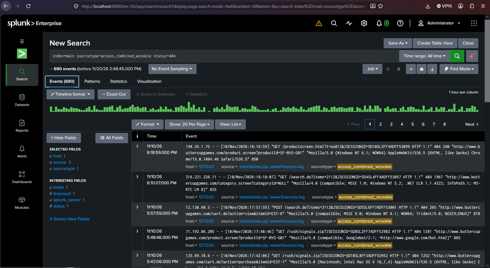
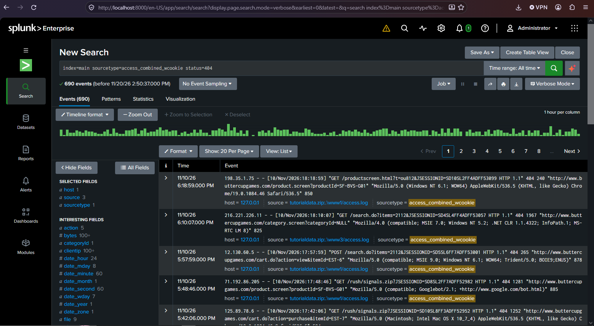
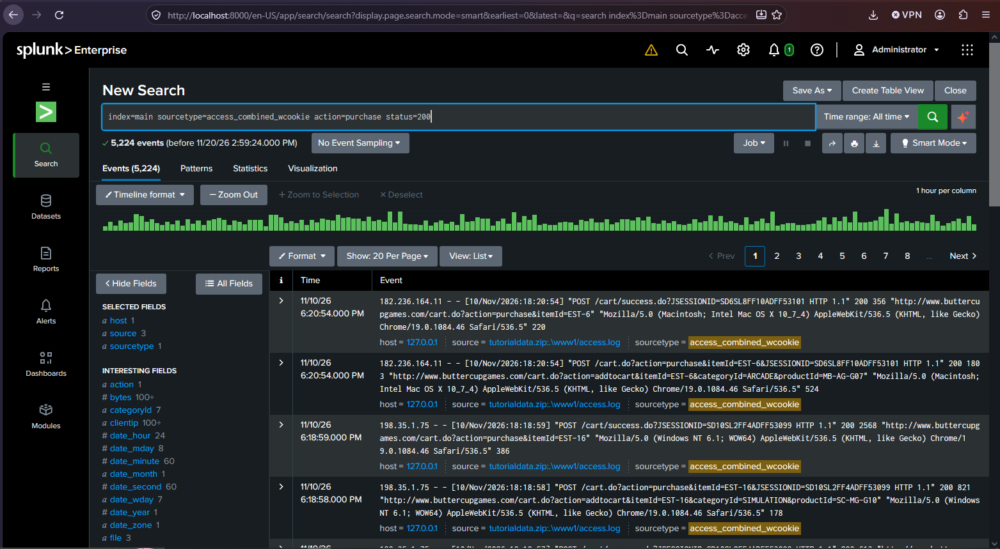
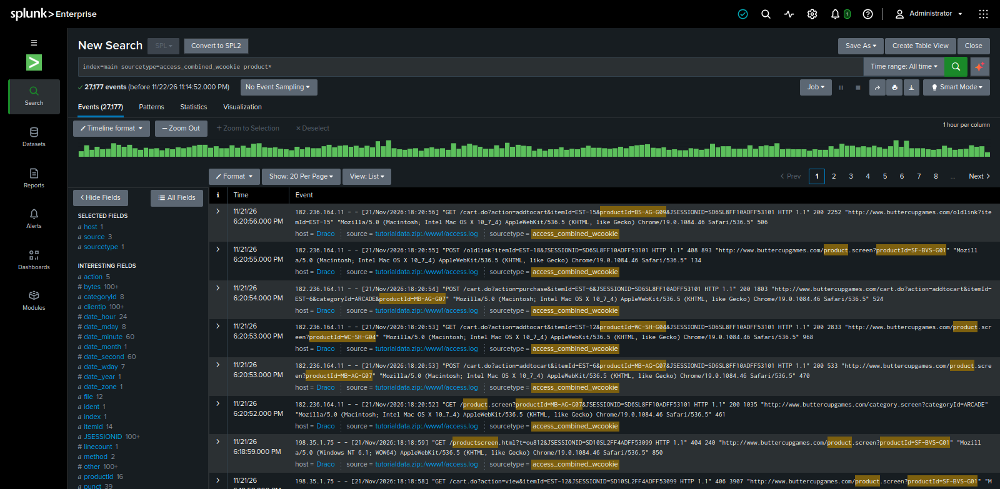
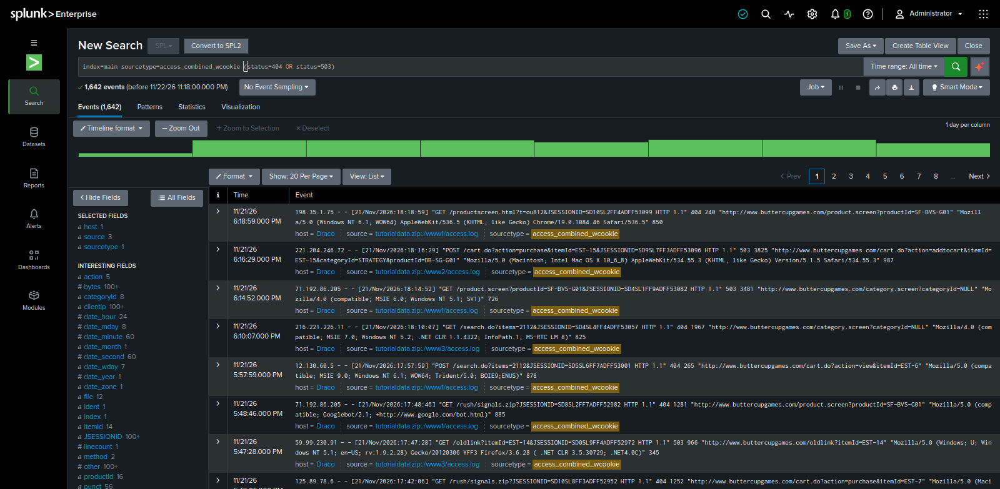
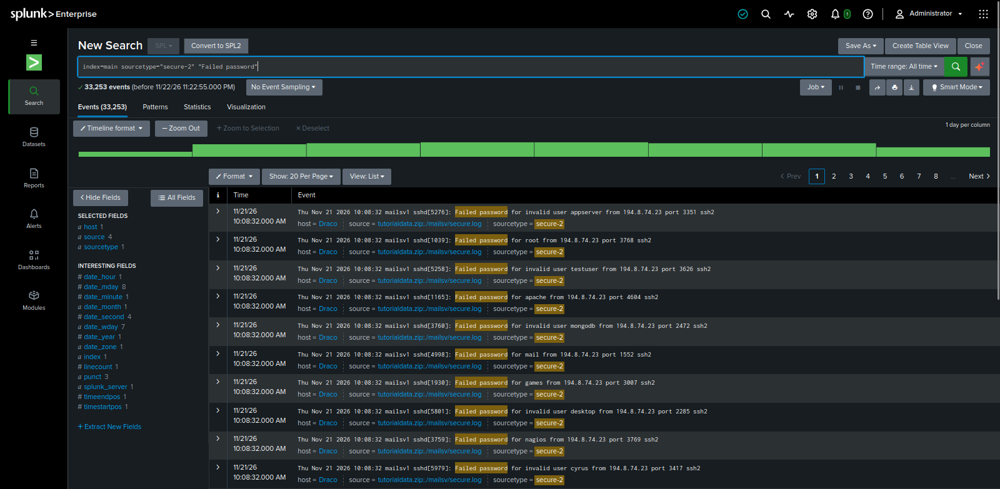
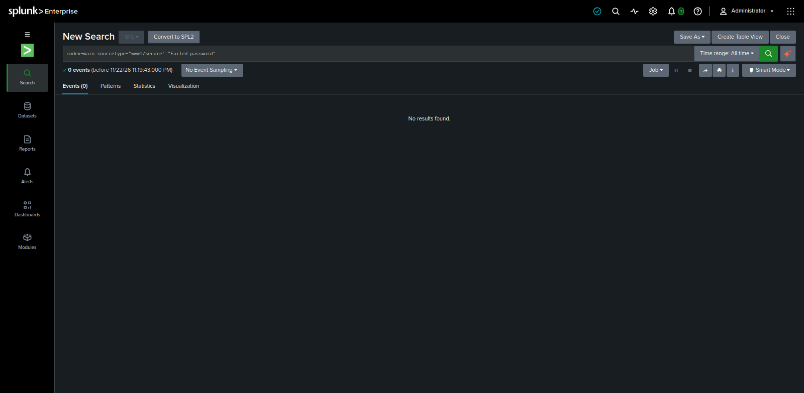

# Splunk Learning Journey

Hands-on documentation of my Splunk learning plan: searches, field extractions, reports, alerts and dashboards, with screenshots and the SPL behind each one.

**Author:** Khulekani Mtshali · [LinkedIn](https://linkedin.com/in/khulekani-mtshali) · [GitHub](https://github.com/xxiv-karatz)

## Environment

- Splunk Enterprise (60-day trial), installed locally
- Data: Splunk's tutorial data (web server logs, Linux authentication logs and vendor sales records). No real or sensitive data.

## Progress

| Week | Focus | Status |
|------|-------|--------|
| 1 | Foundations: searching, field extraction, reports, first dashboard | In progress |
| 2 | Alerts | Not started |
| 3 | TBC | Not started |
| 4 | Roles and users | Not started |

## Skills demonstrated

- Installing and licensing Splunk Enterprise
- Searching with keywords, wildcards, `NOT`, `OR` and time ranges
- Choosing between Fast, Smart and Verbose search modes
- Reading authentication logs to spot a password-guessing pattern
- Troubleshooting searches that return no results

---

<details open>
<summary><h2>Week 1: Foundations</h2></summary>

### What happened

I set up Splunk Enterprise on the trial licence, loaded the tutorial data and learned how to search it. I compared the three search modes, then ran keyword, wildcard and `OR` searches across the web and authentication logs. Two searches returned nothing at first, and working out why taught me to check the time range and the exact sourcetype name before assuming the data is missing. The most interesting result was in the authentication logs, where one IP address tried dozens of different usernames.

### Checklist

- [x] Splunk installed and practice data uploaded
- [x] Search events with keywords, wildcards and time ranges
- [ ] Summarise data with `stats`, `top`, `rare` and `table`
- [ ] Extract fields and explain what a sourcetype is
- [ ] Save searches as reports and show results on a dashboard

### Setup

Installed Splunk Enterprise and confirmed the Enterprise Trial licence under Settings, Licensing: 500 MB daily indexing limit, no licensing alerts or violations. I'm staying on the trial licence rather than switching to Splunk Free, because Free removes scheduled alerts and user management, which I need in later weeks.



Loaded Splunk's tutorial data and checked it with `index=* | stats count by index, sourcetype` over All time. It contains 109,880 events in the `main` index across four sourcetypes: `access_combined_wcookie` (web server logs), `secure-2` (Linux authentication logs), `vendor_sales` (sales records) and `csv` (a small CSV file).


### Interface and search modes

The time picker controls which events a search covers. The tutorial data is timestamped in November 2026, so a narrow range like Last 24 hours can miss it. All time returns everything.



Splunk has three search modes.



I ran the same search (`status=404`, 690 events) in two modes. Fast mode showed 7 fields in the sidebar. Verbose mode showed many more, including `clientip`, `action` and `bytes`, which Fast mode left out. Smart mode, the default, behaved like Verbose on this event search.

| Fast | Verbose |
|------|---------|
|  |  |

### Searching

| Search | Events | What it shows |
|--------|--------|---------------|
| `action=purchase status=200` | 5,224 | Successful purchases |
| `product*` | 27,177 | Any event with a term starting "product" |
| `(status=404 OR status=503)` | 1,642 | Not found and service unavailable errors |
| `sourcetype="secure-2" "Failed password"` | 33,253 | Failed SSH logins |

**Keyword search.** Two field filters combined return only events that match both.

```spl
index=main sourcetype=access_combined_wcookie action=purchase status=200
```



**Wildcard search.** The `*` matches any characters after "product", so it picked up `productId` values and `product.screen` pages.

```spl
index=main sourcetype=access_combined_wcookie product*
```



**OR search.** The brackets keep the `OR` grouped so it applies only to the two status values.

```spl
index=main sourcetype=access_combined_wcookie (status=404 OR status=503)
```



**Failed logins.** The results show repeated attempts from a single IP address (194.8.74.23) trying many usernames, including `root`, `apache` and `nagios`, many of them invalid users. That is a typical SSH password-guessing pattern. Splunk did not extract the IP address as a field here, which is something I can fix with the field extractor later this week.

```spl
index=main sourcetype="secure-2" "Failed password"
```



### Challenges and fixes

**Problem:** My first search returned 0 events.
**Fix:** The time range was set to All time (real-time), which only shows events as they arrive. Switching to the standard All time option returned the data.

**Problem:** `sourcetype="www1/secure" "Failed password"` returned 0 events.
**Fix:** On this instance the authentication logs were indexed as `secure-2`. I ran `index=main | stats count by sourcetype` to find the real name and updated the search.



### What I learned

- A sourcetype tells Splunk how to parse a data source (timestamps, line breaking and fields). Names depend on how the data was uploaded, so they can differ between instances.
- Fast mode turns field discovery off for event searches, Verbose returns all event and field data, and Smart (the default) turns field discovery on for event searches.
- Wildcards use `*`. `OR` needs brackets so it stays grouped, and sourcetypes containing slashes or hyphens need quotes.
- When a search returns nothing, I check the time range first, then the sourcetype name.

</details>

<details>
<summary><h2>Week 2: Alerts</h2></summary>

Coming soon.

</details>

<details>
<summary><h2>Week 3</h2></summary>

Coming soon.

</details>

<details>
<summary><h2>Week 4: Roles and users</h2></summary>

Coming soon.

</details>

---

*Screenshots are cropped to remove browser bookmarks and personal details.*