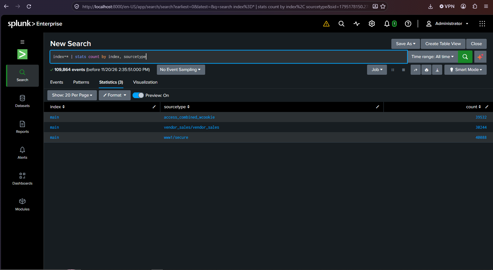

# Splunk Learning Journey

Hands-on documentation of my Splunk learning plan: searches, field extractions, reports, alerts and dashboards, with screenshots and the SPL behind each one.

**Author:** Khulekani Mtshali · [LinkedIn](https://linkedin.com/in/khulekani-mtshali) · [GitHub](https://github.com/xxiv-karatz)

## Environment

- Splunk Enterprise (60-day trial), installed locally
- Data: sample web server logs and Splunk tutorial data (no real or sensitive data)

## Progress

| Week | Focus | Status |
|------|-------|--------|
| 1 | Foundations: searching, field extraction, reports, first dashboard | In progress |
| 2 | Alerts | Not started |
| 3 | TBC | Not started |
| 4 | Roles and users | Not started |

## Skills demonstrated

- Installing and licensing Splunk Enterprise
- Searching with keywords, wildcards and time ranges
- Summarising data with `stats`, `top`, `rare` and `table`
- 

---

<details open>
<summary><h2>Week 1: Foundations</h2></summary>

### What happened

Write 3 to 5 sentences in your own words: what you set out to learn, what you did, and what stood out.

### Setup

Installed Splunk Enterprise and loaded the tutorial data.




### Searching

Keyword, wildcard and time-range searches.

```spl
index=main sourcetype=access_combined status=404
```


### Summarising data

**Which IP made the most requests?**

```spl
index=main sourcetype=access_combined
| stats count by clientip
| sort - count
| head 10
```


### Field extraction

| Field | Method | Purpose |
|-------|--------|---------|
| | | |


### Reports and saved searches

| Name | SPL | What it shows |
|------|-----|---------------|
| | | |

### Dashboard


### Challenges and fixes

- **Problem:** 
  **Fix:** 

### What I learned

- A sourcetype tells Splunk how to parse a data source (timestamps, line breaking, fields).
- 

</details>

<details>
<summary><h2>Week 2: Alerts</h2></summary>

Coming soon.

</details>

<details>
<summary><h2>Week 3</h2></summary>

Coming soon.

</details>

<details>
<summary><h2>Week 4: Roles and users</h2></summary>

Coming soon.

</details>

---

*Screenshots are cropped to remove usernames, hostnames and credentials.*